<div align="center">


# AASIOM Command OS

**The office operating system for the Deputy Municipal Commissioner, Zone II (BMC).**
One desk for every appointment, visitor and commitment. Humans approve everything.


<br />

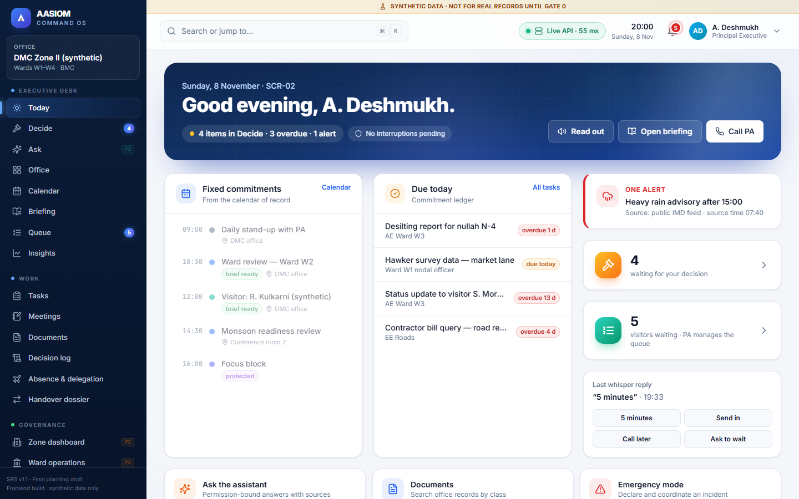

</div>

---

## ✨ What it is

A full-stack implementation of the **SRS v1.1** for AASIOM Command OS. The frontend covers all **62 screens** in the screen map. The backend implements every endpoint in the [API contract](docs/BACKEND_API_CONTRACT.md) and **enforces every rule on the server**.

| | |
|---|---|
| 🗓️ **Executive desk** | Today, Decide queue, calendar with focus blocks, morning briefing, Peace Mode, absence and delegation |
| 🧑‍💼 **PA command centre** | Request inbox, live visitor queue with wait estimates, follow-up board with weekly nudge caps, drafts and outbox, silent whisper |
| 🛂 **Reception & kiosk** | Fast walk-in registration, tokens, right-desk routing, offline tokens, a Marathi/English self-service kiosk |
| ✅ **Commitment ledger** | Every instruction tracked to verified closure, using a server-enforced task state machine |
| 🏛️ **Governance OS** | Zone and ward exceptions, statutory and legal tracking, emergency mode, dak, inspections, Participate Mumbai CSR pipeline |
| 🤖 **AI assistant** | Grounded, cited answers; voice-to-task; minutes extraction; drafting. A server-side gateway with Groq → Gemini → Mistral fallback. Refuses sanction, sign and enforcement intents. |
| 🔐 **Security by design** | Role-based access for 13 roles, a SHA-256 hash-chained audit ledger, approval records, and a separate encrypted Private app |
| 🌏 **Built for the office** | English · मराठी · हिन्दी, dark mode, 200% text, voice read-out, keyboard shortcuts, `Ctrl+K` command palette |

## 🚀 Quick start

Requires **Node.js 20+**.

```bash
git clone https://github.com/dineshsaininit/operating_system_new.git
cd operating_system_new
npm run setup      # installs frontend + backend, creates the env files
npm run dev        # starts both together
```

Open **http://localhost:5173**, pick a role, and sign in. The passkey is simulated, and any digits work for code-based roles. The **Live API** pill in the top bar shows that the frontend is talking to the backend.

> **AI features:** add your keys to `backend/.env` (`GROQ_API_KEY`, `GOOGLE_API_KEY`, `MISTRAL_API_KEY`). Keys live **only on the server** and never reach the browser.

| Command (repo root) | What it does |
|---|---|
| `npm run setup` | Install both apps and create `backend/.env` and `frontend/.env.local` |
| `npm run dev` | Backend on `:8000` and frontend on `:5173`, with labelled output |
| `npm test` | Run the 27 backend integration tests |
| `npm run typecheck` | Type-check both apps |
| `npm run build` then `npm start` | Single-port production mode: the backend serves the built UI on `:8000` |
| `npm run seed` | Reset the backend's synthetic dataset |

## ☁️ Deploy to Render

[](https://render.com/deploy?repo=https://github.com/dineshsaininit/operating_system_new)

One web service, using [`render.yaml`](render.yaml): the backend serves the built UI and the API from one HTTPS URL. During setup Render asks for `GROQ_API_KEY`, `GOOGLE_API_KEY` and `MISTRAL_API_KEY`. They're optional, and the app falls back to plain record search without them. On the free plan the service sleeps after 15 minutes idle (the first visit takes about a minute), and the synthetic data resets on each restart or redeploy.

## 🏗️ Architecture

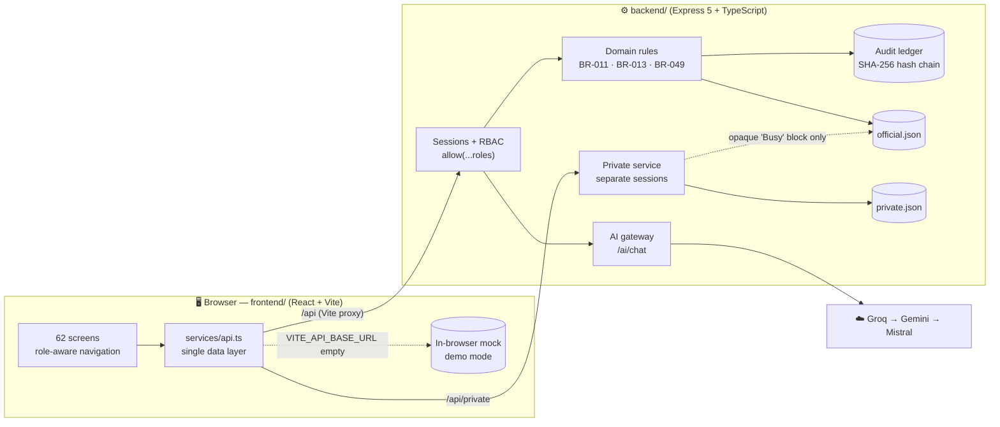

- **One data seam.** Every screen reads and writes through `frontend/src/services/api.ts`. With `VITE_API_BASE_URL=/api` it talks to the backend; with it empty, the same UI runs entirely in the browser on synthetic data.
- **Shared types.** The backend imports `frontend/src/types`, so both sides use one data contract.
- **The server is the authority.** UI role checks are only for convenience. The backend re-checks every permission and rule, and audits denials.

## 📸 Screens

| | |
|:---:|:---:|
| 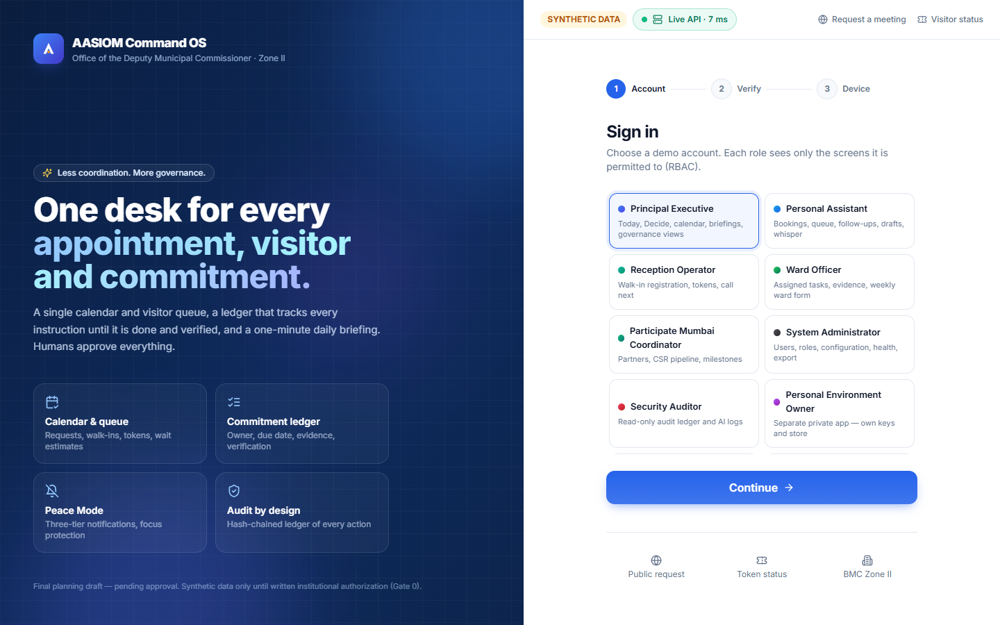 **Sign-in:** role, MFA, device binding | 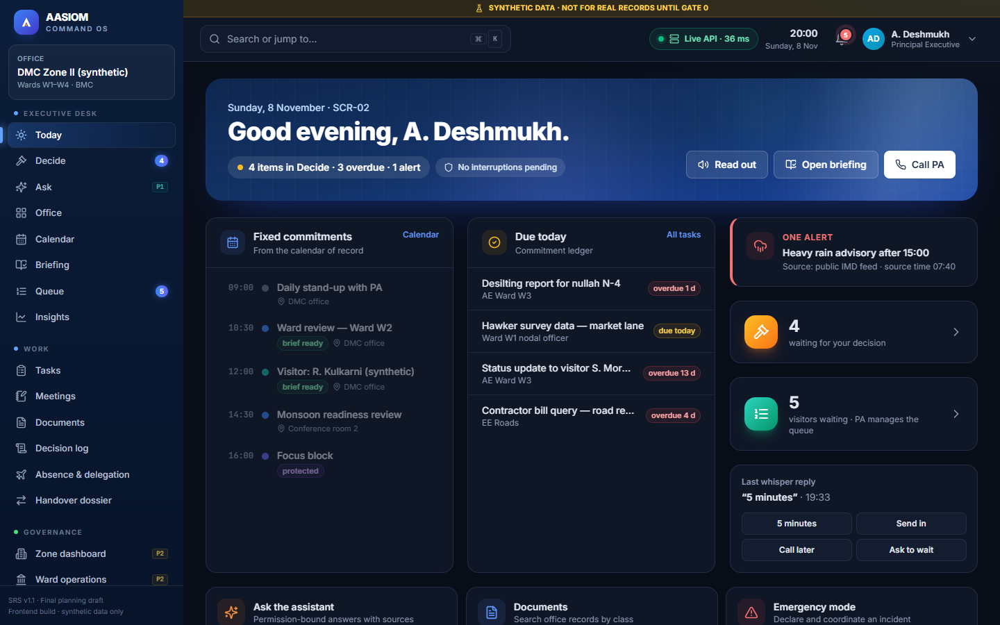 **Today:** dark mode |
| 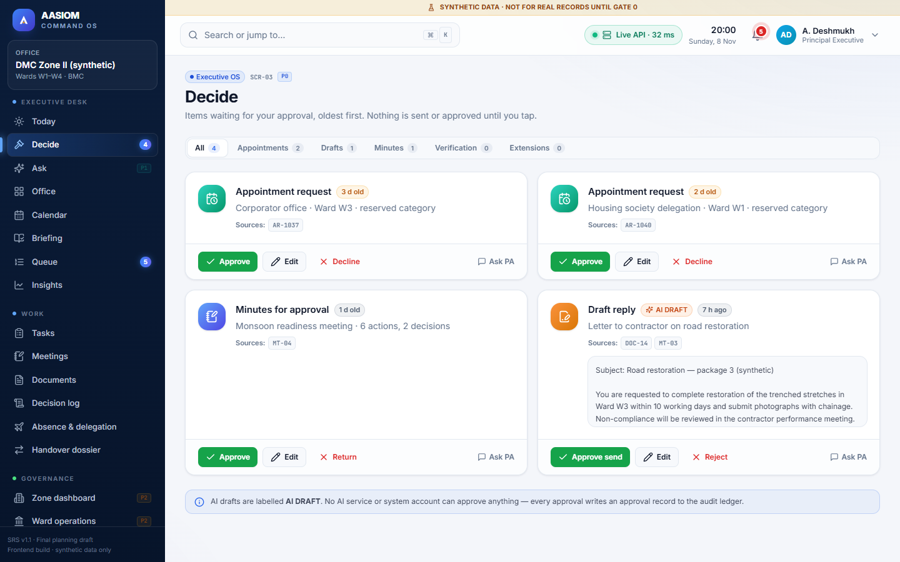 **Decide:** approvals with read-back | 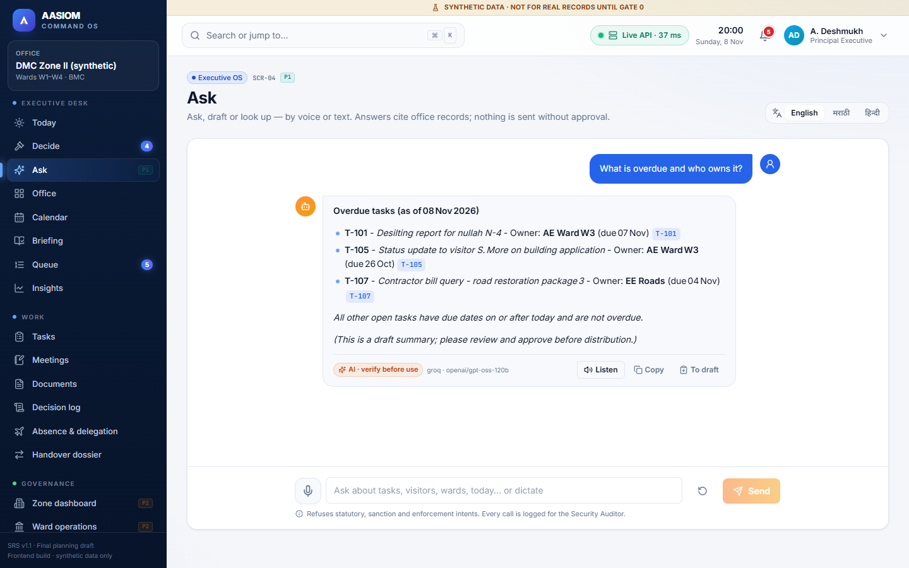 **Ask:** cited AI answers via the server gateway |
| 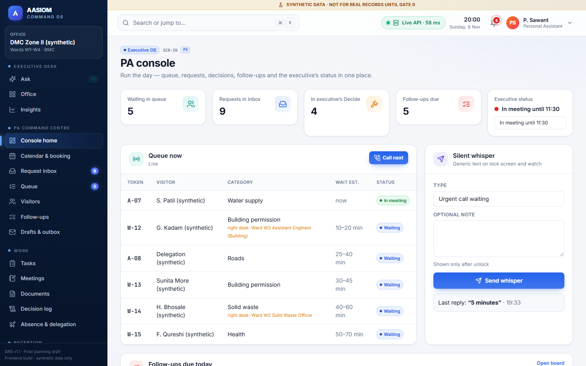 **PA console:** queue, whisper, follow-ups | 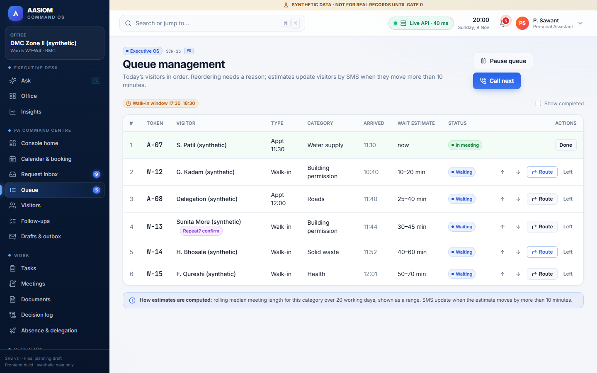 **Queue:** wait estimates, reorder with reason |
| 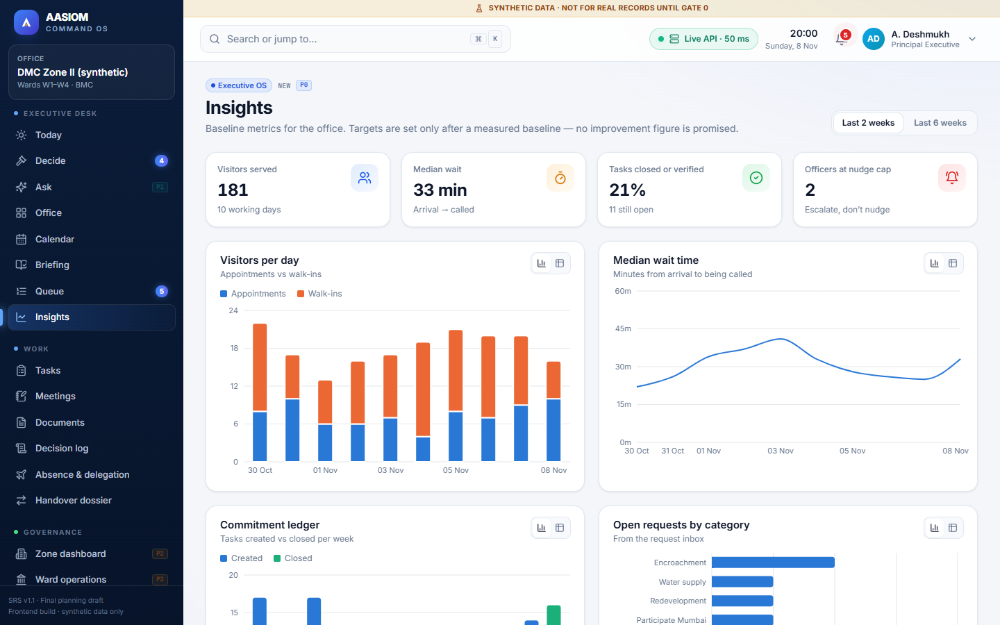 **Insights:** baseline metrics | 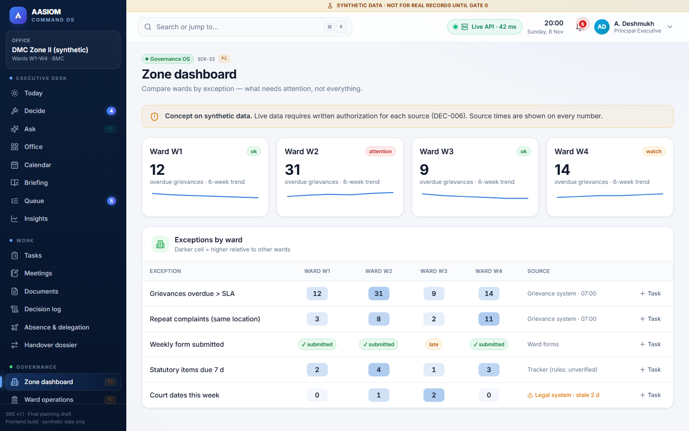 **Zone dashboard:** exceptions by ward |
| 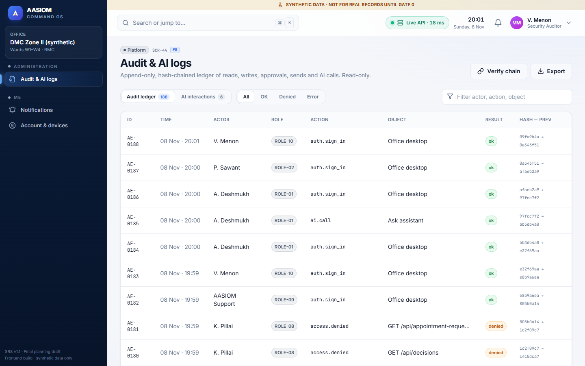 **Audit:** hash-chained ledger | 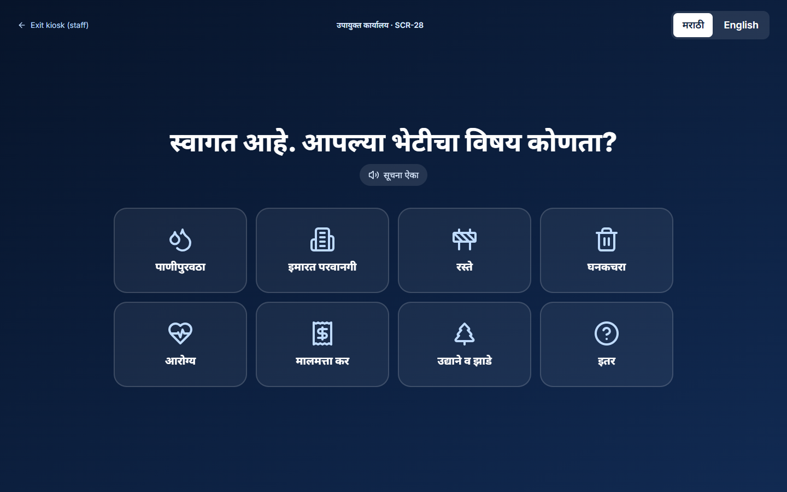 **Kiosk:** Marathi self check-in |

<p align="center">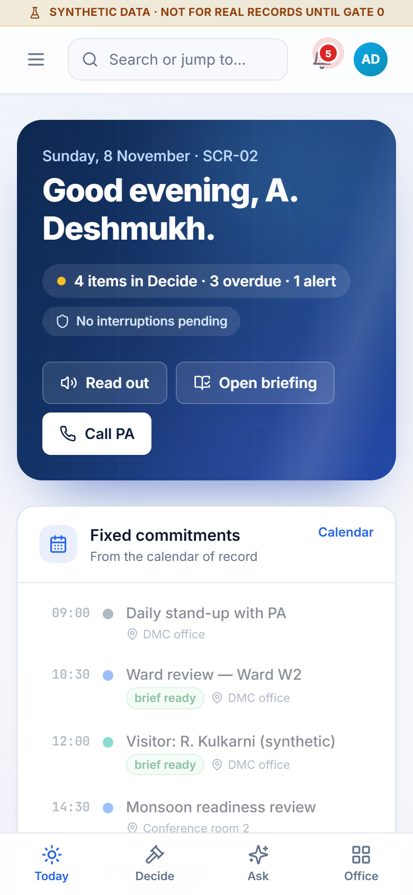<br /><b>Mobile:</b> the executive's four-tab phone layout</p>

## 📁 Repository layout

```
operating_system_new/
├─ frontend/          React + TypeScript + Vite app (all 62 screens)      → frontend/README.md
├─ backend/           Express 5 API — RBAC, rules, audit, AI gateway      → backend/README.md
├─ docs/
│  ├─ BACKEND_API_CONTRACT.md   endpoint contract between the two
│  └─ screenshots/
├─ scripts/           dev launcher (runs both) + first-run env setup
└─ package.json       root commands
```

## 🛡️ Rules enforced on the server

Task state machine (BR-011) · weekly nudge cap (BR-013) · reserved categories need the executive · absence without a delegation record holds, never routes (BR-049) · an approval record for every approval · only approved drafts can be sent · SMS blocked without an approved sender ID · Restricted documents for ROLE-01 only · CSR execution needs an approval reference · Private data fully isolated · **no AI or system account can approve anything.** See [backend/README.md](backend/README.md#how-the-contracts-server-side-rules-are-enforced) for details.

## ⚠️ Synthetic data only

Every name, ward and figure in this repository is fictional. Under the SRS (BR-048, Gate 0), **no real BMC, visitor or officer data** may enter any environment until written institutional authorization exists. This project is a final planning draft pending founder and stakeholder approval.

<div align="center"><sub>Built by the AASIOM Command OS team · frontend and backend developed together</sub></div>
